::: {.home-hero}
::: {.eyebrow}
TÜBINGEN · MUNICH · REMOTE
:::

```{=html}
<h1>BSc/MSc projects and research internships</h1>
```

::: {.hero-copy}
Research on light, sleep and circadian rhythms. Projects include human experiments, evidence synthesis, engineering and social research. Scope and suitability for BSc or MSc requirements are agreed individually.
:::

::: {.hero-foot}
Theses · Research internships · Erasmus+ placements · Engineering projects
:::
:::

::: {.programme-call}
::: {.programme-heading}
```{=html}
<span class="programme-mark"></span>
```

## CaCTüS summer internships 2027 {#cactus}
:::

**Applications are open. Deadline: 16 November 2026.** The application window opened on 21 October 2026.

CaCTüS offers paid, three-month research internships in Tübingen or Stuttgart during **July–September 2027**, through the Max Planck Institutes for Biological Cybernetics and Intelligent Systems and the Tübingen AI Center. Projects cover machine learning, neuroscience, cognition and related fields.

The programme is aimed at BSc/MSc students whose access to research and higher education is constrained by personal, financial, regional or social circumstances. Applicants must not have started a PhD; undergraduates must have completed at least four semesters before the internship. These are voluntary internships and cannot fulfil a compulsory course-credit requirement. See the official guidance for full eligibility and project-specific conditions.

Apply through the **CaCTüS application portal**, choosing from the programme's advertised projects. The programme asks applicants not to send applications by email or contact supervisors to promote an application. Selection and placement are organised centrally; a place in the unit is not guaranteed.

[Apply to CaCTüS 2027 →](https://cactus-apply.tue.mpg.de/registration/cactus-2027) · [Programme and application guidance](https://projects.tuebingen.mpg.de/program) · [Official timetable](https://projects.tuebingen.mpg.de/)

Call checked on **22 October 2026**.
:::



::: {.invitation}
## Suitable academic backgrounds

Projects are suitable for students in health sciences, neuroscience, engineering, computing, education and the social sciences. Each advert lists relevant backgrounds and methods.

[Projects by academic background →](programmes.qmd)
:::
